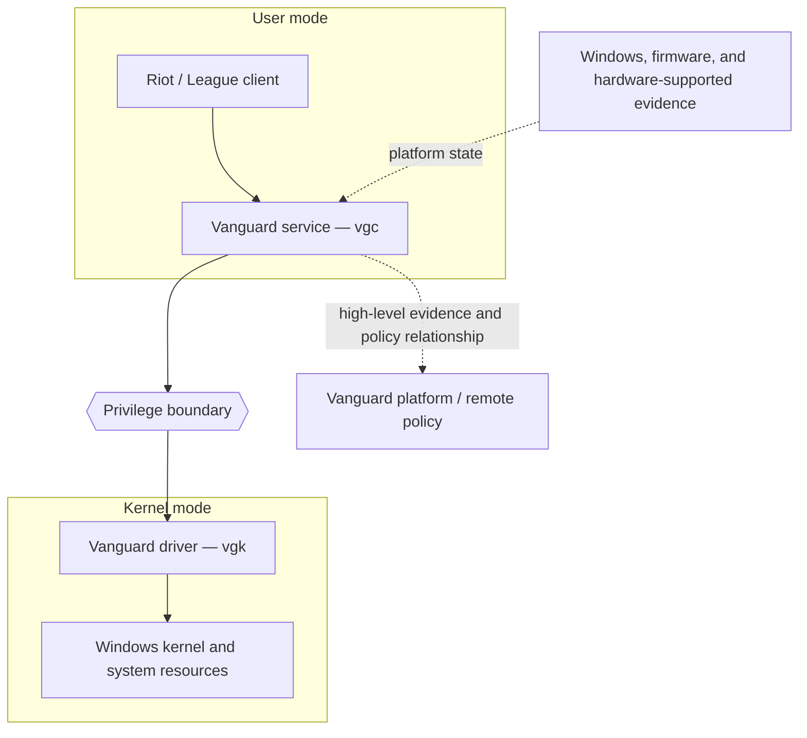
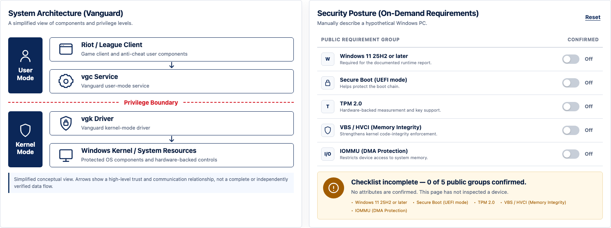
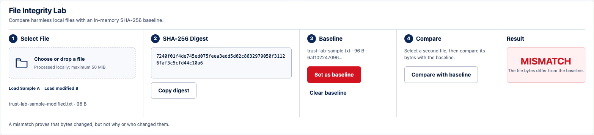

# Vanguard Host Trust: Integrity, Privilege, and Digital Trust

*An Evidence-Bounded System Security Research Project*

This public project examines how Riot Vanguard seeks host-level game integrity and which security, privacy, compatibility, and availability trade-offs follow from privileged enforcement and stronger platform requirements. It combines a traceable research dossier with a small Interactive Security Demonstrator; it is not a product audit or a measurement of a live device.

[](https://github.com/Alierkn/vanguard-trust-lab/actions/workflows/ci.yml)
[](https://github.com/Alierkn/vanguard-trust-lab/actions/workflows/codeql.yml)
[](https://github.com/Alierkn/vanguard-trust-lab/releases)
[](LICENSE.md)

| Project status | Public dossier complete — v1.1.0 |
|---|---|
| Evidence snapshot | 12 July 2026 |
| Evidence base | 15 official public sources · 18 bounded claims |
| Canonical report | [`project/report.md`](project/report.md) |
| Live demonstrator | [Interactive Security Demonstrator](https://alierkn.github.io/vanguard-trust-lab/) |

**Start here:** [Report](project/report.md) · [Demonstrator](https://alierkn.github.io/vanguard-trust-lab/) · [Evidence](research/references.md) · [Reproduce](docs/reproducibility.md) · [Release](https://github.com/Alierkn/vanguard-trust-lab/releases/latest)

## Research question and public contribution

> How does Riot Vanguard seek host-level game integrity, and what security and availability trade-offs follow from privileged enforcement and stronger platform requirements?

The project contributes five linked layers:

1. a frozen register of public Riot, Microsoft, NIST, and W3C evidence;
2. a simplified system model, threat model, and explicit trust boundaries;
3. a comparative analysis of system-start and optional On-Demand operation;
4. a dependency-free demonstrator for posture reasoning and byte integrity; and
5. machine-verifiable traceability, privacy, repository-security, and reproducibility controls.

The report is the principal research output. The browser demonstrator supports selected concepts without pretending to reproduce Vanguard, inspect Windows, or decide device eligibility.

## Work packages and deliverables

| Work package | Question answered | Public deliverables | Status |
|---|---|---|---|
| WP1 — Evidence Governance | What can the public evidence actually support? | [Sources](research/sources.csv), [claims](research/claims.csv), [method](research/methodology.md) | Complete |
| WP2 — System and Threat Modeling | Which assets, components, boundaries, threats, and controls matter? | [Architecture](research/architecture.md), [threat model](research/threat-model.md) | Complete |
| WP3 — Comparative Security Analysis | How do system-start and On-Demand redistribute trust and risk? | [Canonical report](project/report.md) | Complete |
| WP4 — Interactive Demonstrator | Which concepts can be reproduced safely? | [Static app](app/README.md), [demo guide](docs/demo-guide.md), tests | Complete |
| WP5 — Validation and Communication | Can the result be checked, presented, and maintained safely? | [Manifest](project/manifest.json), [presentation guide](project/presentation-guide.md), [Turkish summary](project/summary-tr.md) | Complete |

The complete charter and acceptance criteria are in the [Public Project Dossier](project/README.md). `project/manifest.json` is the machine-readable inventory for the version, work packages, deliverables, metrics, and scope exclusions.

## Six evidence-bounded findings

1. **Privilege is both a control and an assurance burden.** Kernel execution can improve potential visibility and resistance against privileged threats, while increasing the impact of defects, incompatibility, or compromise. [C-001] [C-018]
2. **Integrity, authenticity, and policy acceptance are different.** A hash supports byte equality, a trusted signature supports origin under a trust chain, and a service decision adds policy; none proves complete safety. [C-002] [C-012]
3. **On-Demand changes where historical trust is obtained.** The public model shifts part of the argument from continuous Vanguard observation toward hardened platform state, signed evidence, freshness, and backend interpretation. [C-005] [C-014]
4. **Platform mechanisms are complementary and conditional.** Secure Boot, TPM 2.0, VBS/HVCI, IOMMU protection, and runtime attestation cover different concerns and remain subject to platform and policy conditions. [C-007] [C-008] [C-009] [C-010] [C-011]
5. **Privacy cannot be inferred from privilege or lifetime alone.** Riot describes the user-mode component/platform network relationship, but this project performs no packet or telemetry analysis. [C-015] [C-017]
6. **Availability is part of system security.** Stronger posture requirements can increase assurance for accepted sessions while excluding legitimate users or exposing compatibility and recovery costs. [C-018]

These are conditional findings, not a categorical “safe,” “unsafe,” “private,” or “complete detection” verdict. Claim wording and prohibited overclaims are recorded in [`research/claims.csv`](research/claims.csv).

## System model and trust boundaries



The diagram expresses a simplified teaching model, not a verified packet flow, API sequence, or complete component inventory. Four boundaries structure the analysis:

- **Application boundary:** ordinary client activity versus the security service.
- **Privilege boundary:** isolated user-mode execution versus system-wide kernel authority and failure impact.
- **Platform boundary:** local components versus Windows, firmware, and hardware-supported controls.
- **Network/policy boundary:** local evidence versus remote interpretation and access decisions.

The detailed interpretation is in the [architecture](research/architecture.md), [threat model](research/threat-model.md), and [canonical report](project/report.md).

## Evidence model and traceability

Every material technical conclusion belongs to one of four classes:

| Evidence class | Valid use | Boundary |
|---|---|---|
| Riot statement | Describe what Riot publicly states | Not independent implementation or effectiveness verification |
| Microsoft platform mechanism | Explain documented Windows behavior | Does not reveal Riot's private use or backend policy |
| Project inference | Present a conditional interpretation | Must not be promoted to certainty |
| Demonstrator result | Report behavior reproduced by tests | Applies to this repository, not Vanguard |

Claims use `[C-###]` identifiers and public sources use `[S-*]` identifiers. The 12 July 2026 snapshot contains exactly 15 sources and 18 claims. CI checks identifier registration, source/claim relationships, report structure, manifest consistency, and wording boundaries. See the [human-readable references](research/references.md), [methodology](research/methodology.md), [evidence snapshot](research/evidence-freeze.md), and [limitations](research/limitations.md).

## Interactive Security Demonstrator

The [live static application](https://alierkn.github.io/vanguard-trust-lab/) turns three bounded ideas into observable behavior:

- **System Model** makes the user-mode/kernel-mode privilege transition visible.
- **Posture Model** combines five manually entered public requirement groups without reading the host or reproducing Vanguard Pre-Check.
- **Integrity Demonstrator** compares a local SHA-256 digest with an in-memory baseline.
- **Evidence** explains what the model can and cannot establish.



The app has no backend, analytics, account system, upload endpoint, runtime package dependency, external font, or remote JavaScript. Its Content Security Policy disables runtime connections. Selected files remain inside the browser context and the baseline is cleared on refresh.

### Deterministic integrity result

- Sample A: `98e1521a889fa6ef3e88b60a125bd569f0b6a9c228a4b492e902ef6b2c8e7c9a`
- Modified Sample B: `677197ccc10c1da9241d73ec32413cc125e0fd89616ca6c4637247b85f7e5588`
- Sample A baseline versus Modified Sample B: `MISMATCH`

That result establishes only that the bytes differ. It does not establish authenticity, safety, authorization, malware absence, host posture, or Vanguard effectiveness. [C-012] [C-016] [C-017]



## Reproduce the project

The maintained development matrix uses Node.js 22 and 24 with npm 11. The static app itself runs in a current desktop browser on macOS, Windows, or Linux.

```sh
npm ci --ignore-scripts
npm run ci
npm run serve
```

Open `http://127.0.0.1:8000` for the local demonstrator. `npm run ci` performs syntax checks, deterministic unit and repository tests, evidence and manifest validation, link policy checks, public-metadata scanning, and Git-history release-boundary checks.

For the fixed result only:

```sh
npm test
npm run verify
```

See [Reproducibility](docs/reproducibility.md) and the [Demo Guide](docs/demo-guide.md).

## Repository map

| Path | Purpose |
|---|---|
| `project/` | Canonical report, charter, manifest, presentation guide, and Turkish summary |
| `research/` | Public sources, bounded claims, method, architecture, threat model, ethics, and limits |
| `app/` | Dependency-free Interactive Security Demonstrator deployed to GitHub Pages |
| `tests/` | Deterministic logic, traceability, privacy, and repository-security checks |
| `docs/` | Reproducibility, decisions, publication security, release, and maintenance guidance |
| `scripts/` | Cross-platform serving, validation, link policy, history checks, and checksums |
| `.github/` | Least-privilege CI, CodeQL, Pages, release packaging, and dependency maintenance |

## Limitations, ethics, and public-release security

This repository performs no live Windows or Vanguard measurement and makes no statement about a specific installation, account, player, or device. It excludes reverse engineering, binary inspection, bypasses, cheats, exploits, memory manipulation, traffic interception, kernel development, performance benchmarking, and device certification. Product requirements and platform documentation may change after the evidence snapshot.

The public project contains no student record, institutional mailbox, private source, restricted portal reference, device capture, player telemetry, credential, or player/account data. Git hosting necessarily exposes the repository owner's handle and identities attached to public commits; those platform identities are not presented as institutional project data. Repository checks scan the current tree, deliverable paths, reachable Git history, and release archives. Static hosting uses a restrictive Content Security Policy; GitHub workflows use least-privilege permissions and immutable full-length action pins.

Read [Ethics and Scope](research/ethics-and-scope.md), [Security Architecture](docs/security-architecture.md), [Security Policy](SECURITY.md), and [Disclaimer](DISCLAIMER.md).

Community and maintenance information: [Contributing](CONTRIBUTING.md) · [Security](SECURITY.md) · [Support](SUPPORT.md) · [Code of Conduct](CODE_OF_CONDUCT.md)

## Citation, licensing, and trademarks

Use [`CITATION.cff`](CITATION.cff) for the project citation. Software is MIT-licensed. Original prose and diagrams are CC BY 4.0 unless a file states otherwise. See [License](LICENSE.md), [Attribution](assets/ATTRIBUTION.md), and [Notices](NOTICE.md).

Riot Games, League of Legends, Vanguard, Microsoft, Windows, and other names are trademarks of their respective owners. This independent educational research project is not affiliated with, endorsed by, or sponsored by Riot Games or Microsoft.
