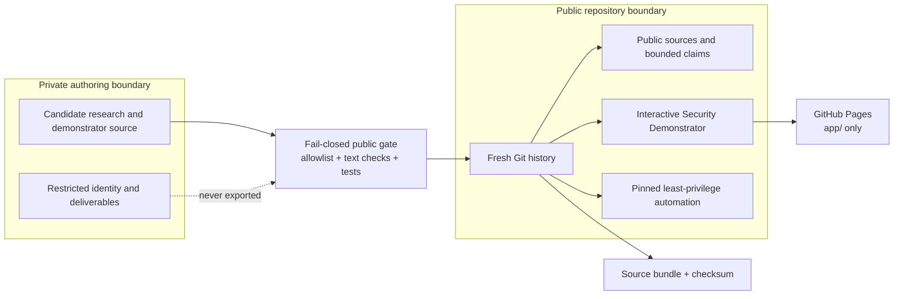
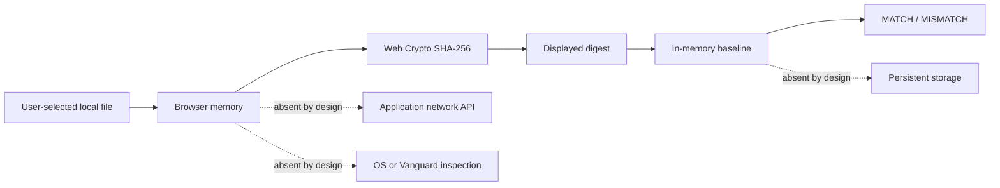

# Security Architecture

## Security objective

The public artifact must be reproducible without expanding trust into privileged software, personal data, third-party runtime code, or private research inputs. Its most important control is the publication boundary: only a deliberately sanitized snapshot receives public Git history.

## Trust and publication boundaries

The public repository is not a sanitized branch of the private repository. It is a separate object database initialized from a reviewed snapshot. No private commit, tag, release, object, or remote is imported.

## Runtime data flow

Source links can be opened by a user, but the application itself does not use `fetch`, `XMLHttpRequest`, WebSocket, EventSource, analytics, or an upload endpoint.

## Enforced invariants

1. Every public Git object belongs to a new, public-only history.
2. Public research claims reference only registered HTTPS sources on approved primary domains.
3. The Interactive Security Demonstrator loads no remote script, style, font, or runtime package.
4. Selected file bytes remain inside the browser context; baseline state is memory-only.
5. Pages publishes `app/` and no other repository path.
6. Workflow tokens default to read-only; write permissions exist only in the job that needs them.
7. External Actions use full immutable commit SHAs and an explicit allowlist.
8. Releases contain a tagged source archive and checksum, never private deliverables or captured data.
9. Unknown personal, private, generated-binary, or workflow classifications fail the repository check.

## Layered controls

| Boundary | Preventive controls | Detective controls | Residual risk |
|---|---|---|---|
| Public Git | Fresh initialization, public-only selection, project identity | PII/path/domain patterns, history and remote audit | Hosting account metadata and future contributor identities remain visible by design. |
| Research | Primary-domain allowlist, source IDs, bounded wording | Claim/source referential checks and correction workflow | Public pages may change; vendor material remains first-party evidence. |
| Browser runtime | Static files, no dependencies, restrictive CSP, no network API | Source inspection, unit/repository tests, CodeQL | A CSP meta policy cannot supply every response-header control. |
| CI/CD | SHA pins, least privilege, locked install, ignored scripts, timeouts | CI, CodeQL, Dependabot, secret scanning | GitHub-hosted runner and Action supply chains remain trusted dependencies. |
| Pages | Deploy `app/` only after full validation | Pages workflow and deployment environment | GitHub Pages does not expose repository-controlled custom security response headers. |
| Release | Tag/version equality, source-only archive, checksum, attestation | Archive content audit and checksum verification | A maintainer can still publish a manual asset; repository policy and host controls must remain aligned. |

## Content Security Policy

The static page uses a CSP meta policy that restricts resources to the same origin and disables application connections, objects, forms, frames, workers, and manifests. It also uses `no-referrer`.

GitHub Pages does not let this repository configure arbitrary HTTP response headers. In particular, frame protection that requires a response header cannot be claimed from a meta policy. If stronger header control becomes necessary, the static site should move to a host that supports version-controlled headers; the zero-network application design remains unchanged.

## Dependency and supply-chain posture

The browser has zero third-party runtime dependencies. Development still trusts Node.js, npm, GitHub Actions, GitHub-hosted runners, and the GitHub platform. This is why locked installs, ignored lifecycle scripts, Action allowlisting, immutable pins, Dependabot, CodeQL, attestations, and short-lived workflow artifacts remain necessary.

## Incident response

If restricted information or a vulnerable artifact is published:

1. stop Pages and release publication;
2. remove or quarantine the affected public surface;
3. assume Git objects and downloaded assets may have been copied;
4. rotate any exposed credential through its issuer rather than relying on Git deletion;
5. rebuild from the private/public classification boundary when history integrity is uncertain;
6. publish a transparent, non-sensitive correction and revalidate the complete artifact.

Security reports about this repository use GitHub private vulnerability reporting. Third-party product vulnerabilities remain outside scope.
