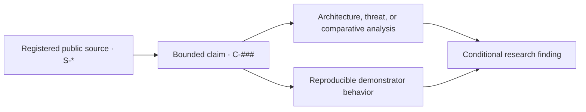

# Public Project Dossier

## Project charter

**Vanguard Host Trust: Integrity, Privilege, and Digital Trust** is an evidence-bounded system-security research project. It asks how Riot Vanguard publicly seeks host-level game integrity and which security and availability trade-offs follow from privileged enforcement and stronger platform requirements.

The project combines a traceable public report, a simplified system and threat model, and a dependency-free Interactive Security Demonstrator. It does not inspect Vanguard, Windows, firmware, accounts, or a real device. Its purpose is to explain where trust is placed, which public evidence supports the model, and which questions remain outside the evidence.

**Version:** 1.1.1

**Status:** Maintained public dossier; v1.1.1 work packages complete

**Evidence snapshot:** 12 July 2026
**Canonical report:** [report.md](report.md)

## Evidence-to-result flow

Vendor statements and platform documentation enter through the source register. Material wording is constrained in the claim register before it is used in the report. Project inference remains conditional; demonstrator behavior is tested separately and never promoted to evidence about Vanguard. The manifest and CI validate the identifiers, counts, paths, report sections, and public-release boundary.

## Research question

> How does Riot Vanguard seek host-level game integrity, and what security and availability trade-offs follow from privileged enforcement and stronger platform requirements?

## Objectives

1. Reconstruct a defensible component and trust model from official public sources.
2. Keep Riot statements, Microsoft mechanisms, project inference, and reproduced demonstrator results separate.
3. Compare the historical system-start continuity argument with optional On-Demand operation.
4. Analyze integrity, authenticity, privilege, privacy, compatibility, and availability without a binary “safe/unsafe” verdict.
5. Provide a safe, cross-platform demonstrator for trust boundaries, posture aggregation, and local SHA-256 comparison.
6. Make every public deliverable reproducible, machine-verifiable, privacy-minimized, and suitable for long-term maintenance.

## Work packages

| Work package | Scope | Principal outputs | Status |
|---|---|---|---|
| WP1 — Evidence Governance | Freeze public sources and bounded claims; record allowed wording and overclaims. | `research/sources.csv`, `research/claims.csv`, evidence snapshot | Complete |
| WP2 — System and Threat Modeling | Identify assets, components, trust boundaries, controls, assumptions, and residual risk. | Architecture and threat model | Complete |
| WP3 — Comparative Security Analysis | Compare system-start and On-Demand trust structures and synthesize findings. | Canonical public report | Complete |
| WP4 — Interactive Demonstrator | Reproduce posture aggregation and byte-integrity concepts without host inspection. | Static browser demonstrator and deterministic tests | Complete |
| WP5 — Validation and Communication | Verify traceability, privacy, security, reproducibility, and presentation readiness. | CI checks, presentation guide, Turkish summary | Complete |

## Deliverables

| ID | Deliverable | Audience | Path |
|---|---|---|---|
| D1 | Public evidence register | Reviewers and maintainers | [`research/`](../research/README.md) |
| D2A | Simplified system architecture | Security readers | [`research/architecture.md`](../research/architecture.md) |
| D2B | Threat and control model | Security readers | [`research/threat-model.md`](../research/threat-model.md) |
| D3 | Canonical research report | General and technical readers | [`project/report.md`](report.md) |
| D4 | Interactive Security Demonstrator | Learners and presenters | [`app/`](../app/README.md) |
| D5 | Reproducibility and validation package | Reviewers and maintainers | [`docs/reproducibility.md`](../docs/reproducibility.md), [`tests/`](../tests) |
| D6 | Ten-slide presentation guide | Presenter | [`project/presentation-guide.md`](presentation-guide.md) |
| D7 | Short Turkish summary | Turkish-speaking readers | [`project/summary-tr.md`](summary-tr.md) |
| D8 | Machine-readable project manifest | Automation and reviewers | [`project/manifest.json`](manifest.json) |

## Completion criteria

- The public report contains every required section and stays between 3,500 and 5,000 words.
- All report claim and source identifiers exist in the frozen public registers.
- The manifest version matches `VERSION`, package metadata, and citation metadata.
- The root README explains the problem, method, deliverables, findings, and limits before introducing the demonstrator.
- Posture logic and fixed SHA-256 results remain deterministic.
- The app performs no runtime network request and retains its restrictive Content Security Policy.
- Public-tree and Git-history checks reject personal, institutional, local-path, private-portal, archive, Office, and PDF material.
- CI runs on Node 22 and 24; CodeQL and GitHub Pages remain independent required checks.

## Scope boundary

This project is not a product audit, host assessment, eligibility check, performance benchmark, reverse-engineering study, or anti-cheat effectiveness test. It includes no bypass, exploit, evasion, packet capture, memory inspection, driver development, device certification, private source, or personal data. The conclusions apply only to the registered public evidence snapshot and the repository's own reproducible behavior.

## Machine-readable status

[`manifest.json`](manifest.json) is the canonical inventory for work-package identifiers, deliverable paths, version, metrics, and scope exclusions. Repository verification checks it against the human-readable dossier and root metadata.
