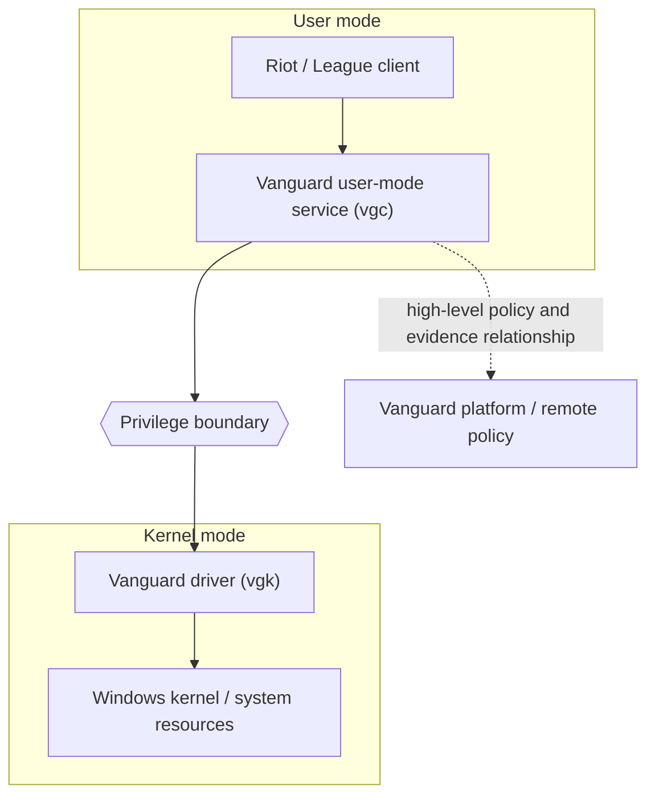

# Simplified Public Architecture

## Public component interpretation

- The Riot or League application and Vanguard user-mode functions operate above the operating-system privilege boundary.
- The `vgk` driver executes in kernel mode and therefore has broader authority and a larger failure impact than an ordinary process.
- Windows supplies code integrity, boot protection, hardware-backed measurement, and DMA-remapping mechanisms relevant to the On-Demand model.
- A remote Vanguard platform ultimately interprets evidence and applies service policy.

## Trust boundaries

1. **Application boundary:** ordinary application activity versus the Vanguard user-mode component.
2. **Privilege boundary:** user-mode service versus kernel-mode driver.
3. **Platform boundary:** driver observations versus Windows mechanisms and hardware-backed controls.
4. **Network/policy boundary:** local evidence versus remote interpretation and access decision.

## Important limitation

The arrows express high-level relationships useful for teaching. They are not a verified packet flow, API sequence, complete component inventory, or reverse-engineered model. No claim is made that the public labels reveal Riot's full implementation.
